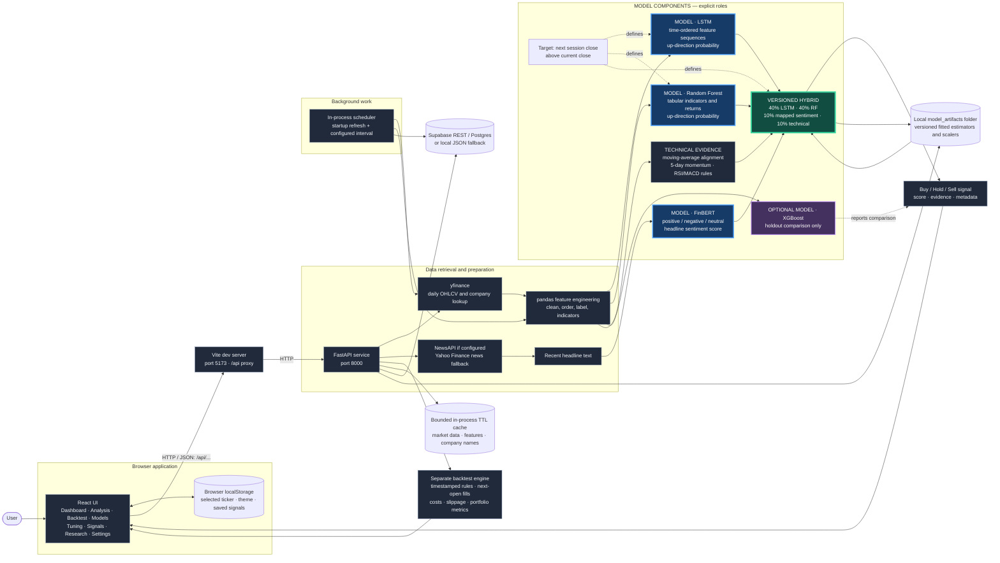

# DeepSignal — Complete Project Guide

This guide describes the application as it exists in this repository: its architecture, pages, data flow, models, evaluation and backtesting, persistence, scheduled work, setup, APIs, and limitations. It is intended to be the main technical and user-facing reference for the project.

> **Purpose:** DeepSignal is an educational stock-analysis and machine-learning research prototype. It does not place trades, provide financial advice, or guarantee a prediction or return. Market data from Yahoo Finance can be delayed, incomplete, or unavailable.

## Contents

1. [At a glance](#1-at-a-glance)
2. [System architecture](#2-system-architecture)
3. [User interface and workflows](#3-user-interface-and-workflows)
4. [Market data, news, and features](#4-market-data-news-and-features)
5. [Prediction models and the hybrid signal](#5-prediction-models-and-the-hybrid-signal)
6. [Saved model artifacts and versioning](#6-saved-model-artifacts-and-versioning)
7. [Evaluation and backtesting](#7-evaluation-and-backtesting)
8. [Caching and scheduled market-data updates](#8-caching-and-scheduled-market-data-updates)
9. [Persistence and database design](#9-persistence-and-database-design)
10. [API reference](#10-api-reference)
11. [Project layout](#11-project-layout)
12. [Run the project](#12-run-the-project)
13. [Configuration](#13-configuration)
14. [Validation and troubleshooting](#14-validation-and-troubleshooting)
15. [Security, privacy, and boundaries](#15-security-privacy-and-boundaries)
16. [Current limitations and future work](#16-current-limitations-and-future-work)
17. [Glossary](#17-glossary)

## 1. At a glance

DeepSignal is a local full-stack web app. The browser provides the dashboard and analysis pages. A Python API fetches market data, engineers features, runs model components, combines their evidence, and returns a JSON result. The app can optionally use a hosted Supabase database for online history; without it, the backend writes supported records to local JSON files.

### Main capabilities

- Select a ticker from saved signal history or type a new symbol. The shared ticker control appears on Dashboard, Analysis, Backtest, and Models. It displays a company name from a small built-in list or looks one up through Yahoo Finance.
- Display daily OHLCV market history, a candlestick chart, technical indicators, recent headlines, sentiment, feature importance, and signal evidence.
- Estimate next-session up/down direction with an explicit weighted hybrid of LSTM, Random Forest, FinBERT sentiment, and technical rules.
- Show Buy, Sell, or Hold signals, including the stronger Buy/Sell variants in the backend response.
- Compare models on a chronological holdout and run a separate reproducible chronological evaluation.
- Run a rule-based, next-open backtest with transaction fees, slippage, portfolio tracking, and baselines.
- Save versioned fitted model artifacts and enough metadata to identify the data, preprocessing, configuration, software versions, and target used.
- Periodically refresh and persist daily bars and technical features in a lightweight background thread.
- Store cache, job, model, prediction, and experiment status for inspection through API routes.

### Main technologies

| Area | Technology |
|---|---|
| Browser UI | React, React Router, Vite, Recharts, Lucide icons, CSS |
| HTTP API | FastAPI, Uvicorn, Pydantic |
| Data handling | Python, pandas, NumPy, yfinance, requests |
| Models | TensorFlow/Keras LSTM, scikit-learn Random Forest, Hugging Face FinBERT |
| Optional comparison/explanation | XGBoost, SHAP |
| Hosted persistence | Supabase Postgres through its HTTPS REST API |

The project does not require installing a local database server. Supabase is optional. The backend's local JSON fallback works without it.

## 2. System architecture

The React application and FastAPI service run as separate processes. In local development, Vite serves the web app on port 5173 and forwards `/api` requests to FastAPI on port 8000. The browser never imports or runs the Python model code directly.

The colored boxes marked **MODEL** are the model/evidence components. XGBoost is drawn outside the ensemble because it is an optional comparison model, not a voting component.



### Main request flow: prediction

1. A user selects or types a ticker and chooses a forecast display horizon on Analysis.
2. React sends `GET /api/predict/{symbol}?timeframe=...` to FastAPI.
3. FastAPI normalizes the symbol and gets adjusted daily OHLCV history from Yahoo Finance through `yfinance`.
4. The service hashes the exact downloaded window and calculates indicators. It builds a next-session-up training target from adjacent closes.
5. It retrieves recent headlines from NewsAPI when configured and then Yahoo Finance sources as needed. FinBERT scores up to eight headlines; unavailable news/model output falls back to neutral sentiment.
6. LSTM and Random Forest independently produce probabilities for the same directional target. XGBoost may provide a separate holdout comparison. Technical rules produce a fourth evidence value.
7. `backend/hybrid.py` combines the four compatible inputs using the fixed versioned weights. Thresholds turn the combined score into a signal.
8. The backend creates an accompanying rule-based backtest report, attaches data and model metadata, and persists the prediction when configured.
9. React renders the result and adds the prediction to the browser's signal history.

```mermaid
BACKEND_PIPELINE_DIAGRAM
flowchart TB
    Request[React requests /api/predict with ticker and display horizon]
    Request --> Market[Fetch adjusted daily OHLCV from Yahoo Finance]
    Market --> Provenance[Normalize dates, record as-of time, hash input window]
    Provenance --> Prepare[Build pandas indicators and next-session labels]
    Headlines[NewsAPI when configured, then Yahoo news fallbacks] --> FinBERT[FinBERT scores up to 8 current titles]
    Prepare --> LSTM[LSTM: ordered seven-column sequence, scaler, P up]
    Prepare --> Forest[Random Forest: nine tabular price/volume features, P up]
    Prepare --> Rules[Technical alignment, momentum, RSI/MACD score]
    LSTM --> Hybrid[Versioned weighted score and signal thresholds]
    Forest --> Hybrid
    FinBERT --> Hybrid
    Rules --> Hybrid
    Hybrid --> Response[JSON response with evidence, dates, output, model version]
    Response --> Dashboard[Analysis and Models pages render output]
    Response --> BackendHistory[Prediction and signal record: Supabase or local JSON]
    LSTM -. matching fitted model and scaler .-> Artifact[Local versioned artifact registry]
    Forest -. matching fitted estimator .-> Artifact
    Backtest[Separate close-signal / next-open technical backtest] --> BacktestReport[Experiment report: Supabase or local JSON]
    Scheduler[Separate scheduled data refresh] --> Bars[Bars and job summaries: migration 002 tables or local JSON]
```

The pipeline view expands the deployment architecture into the request-time sequence. The trained estimators produce direction evidence, while FinBERT and technical rules contribute independent inputs before the hybrid. Persistence and browser state are separate outputs.

### Two distinct meanings of “saved”

- **Saved signals in the UI:** Stored in the current browser's `localStorage`. This is what the ticker dropdown and Signals page use. It does not require Supabase and is not synchronized between browsers.
- **Backend prediction/history records:** Saved through Supabase when configured, otherwise to backend JSON. These can be read from `/api/history/predictions`; the UI signal list does not currently import that backend history automatically.

## 3. User interface and workflows

The app uses React Router. All pages share a selected ticker state. The selected ticker is retained in browser local storage, so changing pages does not reset it.

### Shared ticker picker and company name

Dashboard, Analysis, Backtest, and Models share the same ticker control. It contains a text input with a datalist of Apple and tickers found in locally saved signals. The user can choose a suggestion or type another ticker. Typing is normalized to uppercase.

The company name appears beside the input, outside the ticker box. A short built-in map covers common symbols; other valid-looking symbols are looked up by `GET /api/company/{symbol}` after a short pause in typing. The backend caches successful names for one day and lookup misses for 30 minutes. If Yahoo cannot supply a name, the UI says the company name is unavailable. The lookup is a convenience and does not validate that a ticker has usable historical prices.

### Header and appearance

- The theme button switches between light and dark themes. The selected theme is saved in browser local storage.
- The small **Live** badge means the interface can refresh status/data periodically. It does **not** mean exchange-level real-time prices. Its tooltip explains that status refresh is periodic and prices use the latest available daily data.
- Layout, charts, cards, ticker fields, tables, and navigation are styled for desktop and smaller screens. The navigation collapses on mobile. The charts are lazy-loaded to reduce the initial UI bundle.

### Dashboard

Shows browser-saved signal counts, buy/sell counts, average saved confidence, and the data source. The market card lets the user pick a ticker, then loads approximately three months of daily history and displays a candlestick chart, latest available price, period change, indicators, and a directional price-momentum gauge.

Below the gauge, the **Latest Saved Signal** panel shows the most recently saved Buy/Hold/Sell-style result for that selected ticker, confidence when available, and its saved time. It does not infer a Buy or Sell from the gauge. If the browser has no saved signal for that ticker, it links to Analysis to generate one. This means a prediction saved on another browser or only in backend history will not appear in this panel.

Dashboard market history refreshes when the selected ticker changes and then periodically while the page is open. A separate status poll reads `/api/jobs/market-data`. Those refreshes do not make the underlying daily price feed real-time.

### Analysis

Select a ticker, choose 1D, 1W, 1M, or 3M, and run Analyze. The result includes:

- signal, trend, latest close and market date;
- estimated direction score, confidence-style display, and a heuristic predicted-change figure;
- an evidence panel showing component probability, weight, and contribution;
- the feature importance and available SHAP explanation;
- technical indicators and recent news/sentiment;
- an accompanying historical chart and risk/interpretation notes.

The underlying classifier target is always **next-session direction**. The selected horizon changes only the separate predicted-change heuristic; it does not train a 1-week or 1-month price model. Running a new analysis saves/replaces the same ticker+horizon item in browser history, retaining up to 100 signals.

### Backtest

Runs a separate technical momentum/RSI strategy over historical bars, then displays the strategy curve beside buy-and-hold and no-trade. Metrics include return, CAGR, Sharpe, drawdown, exposure, turnover, and executed trades. It is **not** a simulation of the live hybrid prediction signal.

### Models

Shows the model families and invokes a prediction to display model comparison data, chronological holdout dates, feature importance, and SHAP values if available. Random Forest and optional XGBoost holdout results are shown when returned. LSTM validation metadata is recorded in its saved artifact; the Models page's primary comparison report should not be mistaken for the dedicated `/api/evaluate` experiment.

### Tuning

Loads and saves backend settings for LSTM lookback, LSTM units, epochs, Random Forest tree count, transaction-cost percentage, and slippage percentage. The backend validates ranges and writes settings to `backend/tuning_config.json`. The prediction and backtest services read this shared process configuration.

### Signals

Lists prediction results saved by the current browser. The user can clear this browser's signal history. Clearing it does not delete backend/Supabase prediction records.

### Research and Settings

Research summarizes the workflow and methodology. Settings describes the local `/api` path and deployment CORS configuration; it does not expose or edit secrets.

## 4. Market data, news, and features

### Price history

`download_history` requests Yahoo Finance auto-adjusted daily OHLCV bars: open, high, low, close, volume. It normalizes dates, sorts/cleans data, and rejects empty or malformed results. Prediction normally uses a multi-year data window; dashboard history requests three months, while history/evaluation endpoints allow specified periods. Yahoo Finance is an external provider, not a guaranteed feed. U.S. symbols are usually plain tickers (for example `AAPL`); Yahoo uses suffix conventions for some markets (for example `RELIANCE.NS`). A symbol must be recognized by Yahoo and have usable data.

The prediction response distinguishes `market_timestamp`/`as_of` (date of last market bar) from `retrieved_at`/`prediction_timestamp` (when the backend fetched or produced the result). A recent retrieval time does not mean the underlying bar is from the current minute.

### Company-name lookup

`GET /api/company/{symbol}` calls yfinance ticker metadata and returns `symbol`, `company_name`, and `found`. It accepts a restricted ticker-character set and caches the result. Built-in frontend names can be displayed without calling the lookup endpoint. Company metadata is not a substitute for successful price-history validation.

### News collection and FinBERT input

If `NEWS_API_KEY` exists, the backend first tries the NewsAPI Everything endpoint. If fewer than eight headlines were collected or that provider fails, it can add Yahoo Finance search results and then yfinance ticker news. It filters empty/duplicate titles and returns at most eight headlines for sentiment scoring. Provider/network failures are tolerated; prediction continues with an empty or partial news list.

The default sentiment model is `ProsusAI/finbert` from Hugging Face Transformers; `FINBERT_MODEL` can override it. The first use may download model weights into the local Transformers cache and consume disk, memory, and network bandwidth. FinBERT analyzes headline text and returns positive probability minus negative probability, producing a signed score approximately in [-1, +1]. No articles or model failure yields neutral sentiment (0). FinBERT is pretrained; it is not trained from this project's stock history.

### Technical features

Indicators are computed in pandas; TA-Lib is not required.

| Feature | Meaning |
|---|---|
| SMA 20 / SMA 50 | Rolling averages of adjusted daily closing prices. |
| RSI 14 | Rolling gain/loss momentum indicator. Extreme values are clues, not guaranteed reversals. |
| MACD / signal | EMA(12) minus EMA(26), with an EMA(9) signal line. |
| Bollinger bands | SMA(20) plus/minus two rolling standard deviations. |
| `return_1d`, `return_5d` | Change in close over one or five trading observations. |
| `sma20_gap`, `sma50_gap` | Close relative to the corresponding average. |
| `bb_position` | Close position relative to lower/upper Bollinger bands. |
| `volume_change` | Change in volume from the preceding observation. |
| `sentiment` | Current request's aggregate headline sentiment. |

Rolling indicators need a warm-up period. Rows with missing or infinite required feature values are excluded from model fitting.

### Backend data preparation, in execution order

The prediction path is orchestrated in `backend/main.py` by `build_prediction`. It normalizes the ticker, obtains daily bars, records retrieval time and the last bar date, hashes the raw input window, and computes or reuses technical features. It then gathers current headlines, scores them, creates next-session labels for historical rows, and invokes the LSTM and Random Forest paths. The latest feature row is inference input: its next-session target is unknown and is not used as a training label.

`download_history` asks yfinance for auto-adjusted daily bars and normalizes the date column to UTC before removing the timezone for internal calculations. The returned frame contains date, open, high, low, close, and volume. The input fingerprint is SHA-256 over those ordered bar values and is attached to the prediction so the exact source window can be identified later. `indicators` derives rolling and exponential calculations from close and volume. Early rows naturally lack some rolling values; the model paths remove rows missing required inputs. Infinite percentage changes are converted to missing values rather than passed to estimators.

The label is aligned to the row that makes the decision: `target[t] = 1` if `close[t+1] > close[t]`; otherwise it is 0 (down or unchanged). Thus the feature vector at row *t* contains information available through that close, while its label refers to the next trading observation. This is why the most recent row can be scored for inference but cannot contribute a known label. The live backend uses the current headline aggregate as a request-level sentiment value; it does not reconstruct historical news for every training row.

There are two model input matrices because the model families consume different representations:

- **LSTM sequence input:** ordered `close`, `sma20`, `sma50`, `rsi`, `macd`, `bb_upper`, `bb_lower`; each sample is a sliding window of the most recent `lookback` rows. `MinMaxScaler` transforms those columns. The latest sequence produces one sigmoid value in [0, 1].
- **Random Forest tabular input:** `return_1d`, `return_5d`, `sma20_gap`, `sma50_gap`, `rsi`, `macd`, `macd_signal`, `bb_position`, and `volume_change`. It consumes one row at a time and does not scale the values. Although `sentiment` exists in the general feature frame, it is deliberately excluded from the forest input; sentiment has its own FinBERT component in the hybrid.

After these model outputs are ready, the backend computes explicit technical evidence from the latest row, maps it to a 0–1 value, and sends the four compatible values into `backend/hybrid.py`. The API response preserves the raw market dates, component values, weights, weighted contributions, signal rule, feature importance, optional SHAP values, model comparison, and model-version ID. React formats these fields; it does not train or alter the models.

## 5. Prediction models and the hybrid signal

### Target definition

The classifier target is 1 when the next trading session's adjusted close is above the current session's adjusted close, otherwise 0. The decision convention is after the current session close; the outcome is measured at the next session close. It is a **direction** target, not a future dollar-price prediction.

### Model roles

| Component | Role in the live hybrid | Inputs / output |
|---|---|---|
| **LSTM** | 40% of the hybrid | Sequence of recent price/indicator rows; probability of next-session up direction. |
| **Random Forest** | 40% of the hybrid | Tabular returns, gaps, RSI, MACD, Bollinger position, volume change; probability of up direction. |
| **FinBERT** | 10% of the hybrid after mapping | Recent headline text; positive-minus-negative sentiment, mapped to a 0–1 proxy. |
| **Technical rules** | 10% of the hybrid | Moving-average alignment, 5-day return threshold, and RSI/MACD conditions; mapped to a 0–1 score. |
| **XGBoost** | Not in the hybrid | Optional separate model comparison and probability; its result does not vote in the final signal. |

### LSTM

TensorFlow/Keras builds a binary sequence classifier. The live model uses the ordered columns `close`, `sma20`, `sma50`, `rsi`, `macd`, `bb_upper`, and `bb_lower`; a MinMaxScaler transforms them. Defaults are 30 observations of lookback, 48 LSTM units, 0.2 dropout, a 16-unit dense layer, sigmoid output, Adam, binary cross-entropy, batch size 32, and up to 6 epochs with early stopping. The random seed is 42.

The scaler is saved with the fitted LSTM artifact. In the live training path it is fit on the available feature window before the sequence validation split; therefore the reported validation behavior is not a fully untouched chronological test. If TensorFlow is missing/incompatible or there are too few sequences, LSTM probability falls back to 0.5 and metadata records why.

Each sample is one `lookback × 7` array and its label is the following close-direction value. The backend requires at least 80 sequences. It uses the earlier portion for fitting and a trailing validation slice for early stopping; the split point is `max(floor(85% of samples), sample_count - 40)`, so validation is at least roughly 15% until the 40-row cap applies. It restores the best validation weights. A saved matching LSTM and scaler bypass refitting and transform only the latest sequence for inference. A neutral 0.5 fallback is an explicit availability path, not a learned result.

### Random Forest

The forest is a scikit-learn `RandomForestClassifier` with a default of 250 trees, maximum depth 7, minimum leaf size 4, balanced class weights, and seed 42. It uses `return_1d`, `return_5d`, moving-average gaps, RSI, MACD and signal, Bollinger position, and volume change. No scaling is applied. With enough labeled data, a trailing chronological holdout is scored first; then a separate forest is refit on all available labeled rows for the current inference. With fewer than 100 usable rows, the component returns 0.5 and reports insufficient samples.

The live holdout is the latest 20% where possible, with at least 20 test rows and at least 80 earlier fitting rows. The holdout accuracy is descriptive metadata; the inference model is a newly fitted forest using all rows whose next-session label is known. The latest unlabeled row is held aside for the actual score. Feature importance is the forest's impurity-based feature importance, which describes split usage in this fitted forest and is not a causal explanation.

### Optional XGBoost and SHAP

When XGBoost imports and fits successfully, the backend scores it on the Random Forest comparison window, then refits it for an up probability. The comparison uses 180 estimators, depth 4, learning rate 0.05, row/column subsampling of 0.85, log-loss, and seed 42. XGBoost is guarded as optional; failures do not stop the main prediction. It is not included in hybrid weights. SHAP is also attempted for the latest Random Forest input; when unavailable or failing, its explanation is omitted/empty. Random Forest feature importance is separately returned.

FinBERT is different from the locally fitted estimators: it is a pretrained text classifier loaded lazily through Transformers. The backend asks it for positive, negative, and neutral label scores for each of up to eight titles; for each title it computes positive minus negative, then averages the title scores. Its neutral label is not added to the formula. No headlines or an import/inference error produces score 0 and allows price-based components to proceed. Headlines and sentiment accompany the API response; they are not persisted as a separate training corpus.

### Explicit hybrid rule

`backend/hybrid.py` owns the target definition, hybrid version (`weighted-probability-v1`), and fixed weights:

```text
hybrid up score =
    0.40 × LSTM probability-up
  + 0.40 × Random Forest probability-up
  + 0.10 × ((FinBERT score + 1) / 2)
  + 0.10 × technical probability-up
```

The sentiment mapping is a simple, documented proxy, not a calibrated probability. Technical rules add/subtract fixed points, clip the result to [-1, +1], then map it to [0, 1]. The score and its component inputs, weights, and contributions are returned for inspection.

In the technical component, bullish alignment (`close > SMA20 > SMA50`) adds 0.45; bearish alignment subtracts 0.45. A five-day return above +2% adds 0.25 and below -2% subtracts 0.25. RSI below 35 with MACD above its signal adds 0.30; RSI above 65 with MACD below its signal subtracts 0.30. The sum is clipped to [-1, 1], then converted to a probability-like value using `(score + 1) / 2`. These are hand-authored rules and fixed point sizes, not fitted coefficients.

| Combined score | Signal |
|---:|---|
| 0.64 or higher | Strong Buy |
| 0.54 to below 0.64 | Buy |
| Above 0.46 to below 0.54 | Hold |
| Above 0.36 through 0.46 | Sell |
| 0.36 or lower | Strong Sell |

The dashboard's saved-signal card presents the simpler BUY/HOLD/SELL wording and does not derive a signal from the price-momentum gauge. Backend prediction details may include Strong Buy or Strong Sell.

### Confidence and predicted change

The displayed confidence-like number is derived from distance of the combined score from 0.5. It is not a calibrated probability, confidence interval, or percentage chance of profit. The `predicted_change` figure is a separate heuristic based on the combined score, recent 5-day return, and square-root horizon scaling. It is not an output of a regression model and is not a price target. Selecting 1W/1M/3M does not change the model's next-session classification target.

### What the prediction output contains

The `GET /api/predict/{symbol}` response is a structured record rather than a single label. Its main fields have distinct purposes:

| Output | How the backend creates it | How the UI uses it |
|---|---|---|
| `stock_symbol`, `company_name` | Normalized ticker; `company_name` in this prediction payload is initially the ticker placeholder. The frontend resolves a display name separately through `/api/company/{symbol}`. | Labels the selected security, using the separate lookup when available. |
| `market_data`, `as_of`, `latest_close` | Source, interval, last market timestamp, retrieval time, date range, row count, and SHA-256 of the exact bar window. | Shows what data the result is based on and its freshness. |
| `lstm_probability_up`, `classifier_probability_up` | Latest sequence score and latest-row forest score. | Supports component comparison and evidence. |
| `sentiment_score`, `news` | FinBERT signed title scores and up to eight scored titles. | Displays current headline evidence and sentiment. |
| `signal_explanation` | Hybrid score, target, version, weights, each component's value and contribution, and technical factors. | Powers the evidence panel and makes the rule auditable. |
| `signal_type`, `predicted_trend`, `confidence` | Thresholded hybrid score and distance-from-neutral display. | Headline signal and confidence-style presentation. |
| `predicted_change` | Separate horizon-scaled heuristic, not a price-regression model. | Displays an estimated directional change figure with interpretation limits. |
| `technical_indicators`, `feature_importance`, `model_comparison` | Latest indicators, forest importances, holdout comparison and optional SHAP. | Feeds indicator cards and Models/Analysis explanation panels. |
| `model_version` | Deterministic identity for ticker, exact data window, code/configuration, features, and installed package set. | Identifies which saved fitted artifact matched this prediction. |
| `backtest`, `risk_factors`, `analysis_summary` | Separate technical strategy report and explanatory text. | Adds historical context and limitations; backtest is not the hybrid's simulated return. |

Once model construction and inference complete, the API tries to save the result. A storage write failure is returned as a `persistence.status=failed` field while the computed prediction is still returned. This lets the UI show a result while making its save status explicit.

## 6. Saved model artifacts and versioning

`backend/model_registry.py` writes fitted model artifacts under `backend/model_artifacts/` by default (or `DEEPSIGNAL_ARTIFACT_DIR` if configured). It stores a deterministic version identity based on ticker, exact market-data SHA-256 fingerprint and date window, target, ordered feature lists, preprocessing/feature/model-code versions, hybrid version, tuning configuration, sentiment model name, random seeds, and installed package versions.

Each artifact directory contains JSON metadata plus whichever fitted files were actually captured: a Random Forest estimator, optional XGBoost estimator, LSTM Keras model, and LSTM scaler. The metadata records data window/hash, target, feature order and input shape, hyperparameters, package versions, validation status/metrics, model statuses, and inference explanation metadata. The directory is written through a temporary path and atomically renamed to avoid a partially written version. Loading verifies the metadata identity, expected files, model/scaler dimensions, and Random Forest feature order before putting the bundle into the process cache. The version is an identity hash, not a claim that model quality improved.

The full identity includes the complete price-window hash and configuration. Since the hash changes when the downloaded window changes, matching is exact and a new version is usually created after new market bars arrive. FinBERT's pretrained weights are managed by the Hugging Face cache rather than this registry. The registry is for reproducibility and reuse on the same machine; metadata in Supabase does not upload the binary files.

When the same complete identity is requested again, the backend can load the saved model, scaler, and metadata instead of fitting again. If the market data window or identity changes, a different version is created. Saved LSTM, Random Forest, and available XGBoost estimators, the LSTM scaler, and optional Keras model are written as an artifact bundle with JSON metadata; the loader checks identifiers, expected files, input shape, and feature order. A bounded in-process loaded-model cache holds recent versions. Older artifacts are retained for rollback; they are local files, not automatically uploaded to Supabase.

Useful routes:

- `GET /api/models` — list model-version metadata.
- `GET /api/models/{version}` — inspect one version.
- `POST /api/models/{version}/load` — validate and load it into the current backend process.

Loading an artifact does not force its use for a different ticker/data/configuration identity. The pretrained FinBERT weights remain in the Hugging Face cache and are identified by model name; they are not copied into every trained-model artifact. The backtest is rule-based and carries strategy/engine versions instead of a fitted model version.

## 7. Evaluation and backtesting

### Dedicated direction evaluation

`GET /api/evaluate/{symbol}` downloads up to three years of daily history and builds a chronological train/validation/test report for next-session direction. It needs at least 120 usable samples and both classes in fitting data; otherwise it returns an explicit insufficient-data status.

- First 60%: initial training window; the LSTM scaler is fit only on these rows.
- Rows through the first 80% are available to fit/evaluate models before the final holdout. The Random Forest is fit on those first 80%; the LSTM uses an earlier fit portion and an internal validation portion for early stopping.
- Final 20%: shared holdout test window for all compared methods.
- Compares previous-session-direction baseline, Random Forest, LSTM, and weighted hybrid.
- Reports accuracy, precision/recall/F1 for up class, confusion matrix, and simplified trading metrics.
- Reports buy-and-hold and flat-cash baselines and hybrid deltas versus component models.
- Records the data hash, dates, parameters, model/package versions, and assumptions.

Evaluation fits the LSTM scaler using only the earlier 60% training rows. Historical point-in-time news is not available, so evaluation explicitly uses neutral sentiment on all historical hybrid test rows. This means it does **not** validate the live news/FinBERT contribution. The models share final test dates, but this is one final holdout, not repeated rolling retraining of every component.

### Rule-based historical backtest

The Backtest page and `GET /api/backtest/{symbol}` use a separate long-only technical strategy. Signals are created after each daily close using:

- BUY when 5-day return is above 0.6% and RSI is below 72;
- SELL when 5-day return is below -0.6% and RSI is above 28;
- otherwise HOLD.

Signals execute at the next available daily open, which prevents using a future price for the order. Position size targets the configured fraction of equity (default 100%); fractional shares are allowed. Buys/sells include adverse slippage and a percentage transaction cost. The engine tracks cash, holdings, equity, trades, drawdown, exposure, turnover, return, CAGR, and annualized Sharpe. It liquidates any remaining position at the final close with costs.

The report compares the strategy with buy-and-hold (including modeled costs) and no-trade cash. It contains the price-data hash, signal hash, date window, strategy and engine versions, parameters, and execution assumptions. It sets `model_version` to null because it is not a trained-model strategy. The live prediction endpoint also includes a rule-based backtest payload for presentation, but that payload is not a simulation of the prediction ensemble.

### Metrics: what they do and do not say

- **Accuracy:** fraction of direction labels classified correctly; can hide class imbalance.
- **Precision / recall / F1:** focus on the positive/up class and its false alarms/misses.
- **Confusion matrix:** counts actual versus predicted up/down labels.
- **Cumulative return / CAGR:** historical simulated account growth over a selected window.
- **Maximum drawdown:** largest peak-to-trough loss in the reported equity curve.
- **Sharpe:** annualized average return relative to variability under the report's assumptions.
- **Turnover / trade count / exposure:** describe trading activity and time invested.

Metrics depend on provider data, window, thresholds, costs, and implementation assumptions. Past simulation is not a promise of future results.

## 8. Caching and scheduled market-data updates

### In-process cache

`backend/cache.py` provides a bounded, thread-safe TTL cache. It is local to one backend process and clears on restart. It tracks hits, misses, expirations, evictions, and provider call timing.

- Yahoo daily OHLCV requests: 15-minute default TTL (`MARKET_DATA_CACHE_TTL_SECONDS`); 0 disables this cache. Scheduled refresh explicitly bypasses it.
- Technical feature results: keyed by input-data fingerprint and feature-code version; cached for 24 hours.
- Company-name lookups: successful result cached for one day; unsuccessful lookup cached for 30 minutes.
- Prediction response: not cached because market data/news can change.

`GET /api/cache/status` reports cache and TTL details. This cache reduces repeated work but is not shared between backend workers and does not survive restart.

### Scheduler

`backend/scheduler.py` starts a daemon thread during backend startup unless `MARKET_DATA_REFRESH_ENABLED=false`. It immediately attempts a refresh, then waits the configured interval (six hours by default; minimum five minutes). `MARKET_DATA_SYMBOLS` is a comma-separated ticker list, default `AAPL`.

For each ticker it fetches about one year of daily bars, bypasses the request cache, validates missing/duplicate/out-of-order data, computes technical features, and stores bars and features. A ticker is retried up to three times with short exponential delays. The job records start/end times, success/partial/failure state, rows, tickers, and per-symbol failures. Its latest status is available at `GET /api/jobs/market-data`.

The scheduler handles market-data refresh and feature calculation. It does not perform scheduled model fitting/inference. Yahoo determines when daily data becomes available; scheduled polling cannot make that source real-time. A single in-process thread is suitable for this prototype, not a distributed job system.

## 9. Persistence and database design

### Storage choices

The backend talks to Supabase Postgres through HTTPS REST calls using `requests`; no local DB server or Postgres Python driver is required. Set both `SUPABASE_URL` and `SUPABASE_SECRET_KEY` in `backend/.env` to use it. If both are absent, the backend uses local JSON fallbacks. If only one or invalid settings are supplied, storage reports an incomplete/invalid state rather than silently pretending it connected.

The backend persists:

- **Predictions:** prediction response, ticker, horizon, timestamp, signal, model version, input window, data fingerprint, and explanation.
- **Signals:** signal type, timestamp, strategy/hybrid version, reason, and metadata tied to the prediction.
- **Market-data runs:** metadata/fingerprint and reference to the data used by a prediction.
- **Experiments:** evaluation/backtest report, run ID, metric summaries, parameters, versions, date window, and assumptions.
- **Scheduled market bars:** daily OHLCV bars and computed feature JSON for configured tickers, after migration 002 is installed.
- **Background job runs:** scheduler status and details, after migration 002 is installed.

Each record exists to answer a different operational or research question:

| Stored record | Reason to retain it | Important boundary |
|---|---|---|
| Market-data run metadata | Identify the provider, date range, input row count, retrieval time, quality status, and hash that underpinned a prediction. | The live prediction path stores metadata; it does not upload every historical OHLCV row into this table. |
| Prediction | Reopen prior backend outputs and compare ticker, signal, horizon, model version, input window, score, and response. | Backend history is separate from the browser's local signal cards. |
| Signal | Maintain a queryable, prediction-linked signal record with its hybrid version and reason. | It is descriptive output storage; there is no order execution or risk-control engine. |
| Experiment | Preserve a backtest/evaluation run with parameters, metrics, dates, data hash, and assumptions for later inspection or comparison. | It stores the report and provenance, not a guarantee of future behavior. |
| Scheduled bars and features | Retain refreshable OHLCV and derived feature snapshots for configured symbols, keyed by symbol/interval/date. | Only the background refresh writes these rows; migration 002 is required. |
| Job run | Explain whether a scheduled refresh succeeded, partially failed, or failed, how many rows it processed, and per-ticker errors. | Job state is a persisted summary; the scheduler itself still runs in one backend process. |
| Model artifact files | Reuse a fitted estimator and scaler when the complete model identity matches; record enough metadata to inspect the build. | Files remain local unless manually backed up; Supabase stores identifiers/records, not these binaries. |
| Tuning configuration | Keep user-selected model and simulation parameters across backend restarts. | Stored in local `backend/tuning_config.json`, not in the Supabase schema. |
| Backend cache | Avoid repeating provider and feature work during a process lifetime. | Temporary and cleared when the backend restarts. |
| Browser `localStorage` | Keep selected ticker, theme, and up to 100 UI signal snapshots on that browser. | Device/browser-specific; not synchronized with backend prediction history. |

In Supabase, `market_data_runs` is the provenance record referenced by `predictions`; `predictions` holds the result; `signals` has a one-to-one foreign-key link to that result; and `experiments` holds evaluation/backtest report payloads. Migration 002 adds `market_data_bars` (unique by symbol, interval, timestamp) and `background_job_runs`. These are not interchangeable stores: model files are local, the TTL cache is ephemeral, and UI history lives in the browser.

Tables for predictions/signals/market-data runs/experiments are in `backend/sql/001_persistent_storage.sql`. Scheduler tables are in `backend/sql/002_market_data_scheduler.sql`. Both migrations are run in the Supabase Dashboard SQL Editor. They enable row-level security, revoke public/anonymous/authenticated access, and grant the backend service role the intended table access. The secret key belongs only in the backend environment; do not put it in frontend code or commit it.

Without Supabase, local fallbacks include `prediction_runs.json`, `evaluation_runs.json`, `backtest_runs.json`, `market_data_bars.json`, and `job_runs.json` under `backend/`. They are local and ignored by Git. Tuning config and model artifacts are also local. The frontend's browser signal history is separate from all these backend stores.

### Supabase setup

1. Create a Supabase project and copy its Project URL and Secret key.
2. Run `backend/sql/001_persistent_storage.sql` once in that project's SQL Editor.
3. If scheduled bar/job persistence is wanted, also run `backend/sql/002_market_data_scheduler.sql`.
4. Put `SUPABASE_URL` and `SUPABASE_SECRET_KEY` in `backend/.env`, preserving other settings. Never paste the secret into frontend settings or a public place.
5. Restart the backend and open `http://localhost:8000/api/storage/status`. Confirm `status` is `connected`.
6. Run predictions/evaluations/backtests; inspect history via the API. Restarting the backend should not remove Supabase records.
7. Existing local experiment reports can be imported once through `POST /api/storage/import-local-experiments`; run IDs make retries idempotent.

The prediction/history API can save metadata and model outputs without uploading every historical price row. The scheduler separately stores daily bars when migration 002 is applied. Browser-only saved signals are not automatically migrated to Supabase.

## 10. API reference

Interactive API docs are available at `http://localhost:8000/docs` while the backend is running. API responses are JSON. Vite proxies browser `/api` calls to the backend during development.

| Method | Route | Purpose |
|---|---|---|
| GET | `/api/health` | Basic backend health and UTC time. |
| GET | `/api/company/{symbol}` | Resolve a ticker to a company name through Yahoo metadata. |
| GET | `/api/predict/{symbol}?timeframe=1D` | Run live model inference, return signal/evidence, include a rule-based backtest, and persist prediction. Horizons accepted: `1D`, `1W`, `1M`, `3M`. |
| GET | `/api/history/{symbol}?period=3mo` | Return daily OHLCV history. Periods accepted: `3mo`, `6mo`, `1y`, `2y`, `3y`. |
| GET | `/api/backtest/{symbol}` | Run and persist the rule-based next-open backtest. |
| GET | `/api/evaluate/{symbol}` | Run and persist the chronological direction model evaluation. |
| GET | `/api/generalization` | Run the fixed multi-sector example backtest basket. |
| GET | `/api/config` | Read tuning configuration. |
| POST | `/api/config` | Validate and save tuning configuration JSON. |
| GET | `/api/models` | List saved model versions; accepts optional `limit`. |
| GET | `/api/models/{version}` | Return saved version metadata. |
| POST | `/api/models/{version}/load` | Validate/load a saved artifact into the backend process. Requires POST, not browser address-bar GET. |
| GET | `/api/history/predictions?symbol=AAPL` | Read backend-saved predictions; symbol filter is optional. |
| GET | `/api/history/experiments?kind=backtest` | Read evaluation/backtest runs; `kind` is optional. |
| GET | `/api/storage/status` | Check configured storage connectivity or local fallback mode. |
| POST | `/api/storage/import-local-experiments` | Import local evaluation/backtest JSON into configured Supabase. |
| GET | `/api/jobs/market-data` | Scheduler enablement, configured symbols, last run and latest successful refresh. |
| GET | `/api/cache/status` | In-process cache counts and TTL configuration. |

## 11. Project layout

```text
DeepSignal/
|-- backend/
|   |-- main.py                 FastAPI routes, prediction orchestration, features and model calls
|   |-- hybrid.py               Direction target, hybrid version, weights and probability fusion
|   |-- model_registry.py        Artifact identity, persistence, validation and loading
|   |-- evaluation.py            Chronological model evaluation report
|   |-- backtesting.py           Timestamp-aware portfolio simulation engine
|   |-- scheduler.py             Background daily market-data refresh
|   |-- cache.py                 Bounded in-process TTL cache
|   |-- database.py              Supabase REST and local JSON persistence
|   |-- requirements.txt         Backend runtime dependencies
|   |-- requirements-dev.txt     Runtime plus test client dependency
|   |-- .env.example             Safe settings template
|   |-- sql/
|   |   |-- 001_persistent_storage.sql
|   |   `-- 002_market_data_scheduler.sql
|   `-- tests/                   Focused unittest suite
|-- frontend/
|   |-- package.json
|   |-- package-lock.json
|   |-- vite.config.js
|   |-- index.html
|   `-- src/
|       |-- main.jsx             Pages, shared ticker state, API calls, UI logic
|       |-- Charts.jsx           Reusable Recharts components
|       `-- styles.css           Themes, layouts, responsive UI and component styles
|-- docs/
|   `-- DeepSignal_Project_Guide.md  This complete project reference
`-- tools/
    `-- build_project_guide_pdf.py  Rebuilds the guide PDF with Python only
```

Generated directories such as `backend/.venv`, `frontend/node_modules`, `frontend/dist`, `backend/model_artifacts`, local environment files, and local run histories are not source files and are ignored by Git.

### File-by-file responsibilities

The tree above is the quick map. This inventory describes the maintained source and configuration files individually; generated environments, downloaded model weights, caches, and local run-history JSON are runtime data and are intentionally not listed as source.

#### Repository-level files

| File | Responsibility |
|---|---|
| `README.md` | Short project overview, local setup, first prediction, evaluation, backtesting, and Supabase/scheduler guidance. The detailed behavior reference is this guide. |
| `.gitignore` | Excludes virtual environments, installed frontend packages, build output, secrets, local configuration, reports, and fitted artifacts from version control. |
| `.gitattributes` | Repository text-file and line-ending conventions. |
| `.vscode/settings.json` | Workspace editor preferences for contributors using Visual Studio Code. |
| `run_backend.bat` | Windows helper that checks Python, creates the backend virtual environment if needed, copies the safe environment template when absent, installs runtime requirements, and launches Uvicorn on port 8000. |
| `run_frontend.bat` | Windows helper that checks npm, installs locked frontend dependencies when needed, and starts the Vite development server. |

#### Backend Python modules

| File | Responsibility |
|---|---|
| `backend/main.py` | FastAPI application and route definitions; ticker normalization; Yahoo price and company lookups; indicator construction; news collection and FinBERT scoring; LSTM/forest inference and optional comparison; prediction orchestration; tuning configuration; scheduler lifecycle hooks. This is the service composition layer. |
| `backend/hybrid.py` | Defines the next-session-up target contract, hybrid version and component weights; validates probabilities; maps sentiment and produces the auditable weighted result and signal category. |
| `backend/model_registry.py` | Creates stable model identities and version IDs; writes and validates local artifact bundles; restores compatible estimators/scalers; maintains a bounded loaded-model cache. |
| `backend/evaluation.py` | Builds chronological train, validation, and final test windows; compares direction models and baselines on common dates; produces metrics, hashes, assumptions, and a persisted experiment report. |
| `backend/backtesting.py` | Implements the separate timestamp-aware technical strategy; executes orders at the next open; accounts for costs/slippage, cash, shares, equity, baselines, trades, and performance metrics. |
| `backend/database.py` | Storage adapter for optional Supabase Postgres over HTTPS and local JSON fallback; persists predictions, signals, experiments, market bars, and scheduler status. |
| `backend/cache.py` | Bounded, thread-safe in-process TTL cache and cache/provider timing counters. It does not share state between backend processes. |
| `backend/scheduler.py` | Starts/stops the background refresh thread; fetches configured symbols, validates and feature-engineers bars, retries failures, persists data, and reports job status. |

#### Backend configuration and database schema

| File | Responsibility |
|---|---|
| `backend/requirements.txt` | Runtime Python packages needed by the API and its supported model/data paths. |
| `backend/requirements-dev.txt` | Development/test dependency additions on top of runtime requirements. |
| `backend/.env.example` | Safe template for optional provider keys, Supabase settings, cache/scheduler controls, artifact path, and CORS origins. It contains no live secret. |
| `backend/sql/001_persistent_storage.sql` | Creates the core Supabase tables and access policies for prediction and experiment persistence. |
| `backend/sql/002_market_data_scheduler.sql` | Adds scheduled market-bar and refresh-job persistence used by the background scheduler. |

#### Backend test files

| File | Responsibility |
|---|---|
| `backend/tests/test_validation.py` | Checks health/prediction response shapes, signal boundaries, tuning validation/persistence, provider absence, and graceful optional-model failure behavior. |
| `backend/tests/test_routes.py` | Guards route declaration ordering so fixed history routes are not captured by the dynamic ticker route. |
| `backend/tests/test_hybrid.py` | Verifies weighted component arithmetic, audit fields, invalid-input rejection, and shared evaluation comparisons. |
| `backend/tests/test_model_registry.py` | Verifies artifact identity changes and reloading compatible artifacts in a clean process. |
| `backend/tests/test_backtesting.py` | Verifies next-open order timing, portfolio accounting, and cost/slippage reporting. |
| `backend/tests/test_database.py` | Checks local JSON persistence/readback and Supabase request/upsert behavior, including symbol filtering and backend-only secret headers. |
| `backend/tests/test_cache.py` | Checks TTL expiration, copy protection, and avoiding repeated provider calls for cached price history. |
| `backend/tests/test_scheduler.py` | Checks configured ticker selection and refresh validation/persistence summaries. |

The focused tests also exercise evaluation through its shared hybrid comparison logic; there is no separate `test_evaluation.py` file. The full suite is invoked from the repository root with `python -m unittest discover -s backend/tests -v`.

#### Frontend files

| File | Responsibility |
|---|---|
| `frontend/package.json` | Declares React/Vite dependencies and frontend scripts. |
| `frontend/package-lock.json` | Locks the resolved npm dependency tree for reproducible installation. |
| `frontend/vite.config.js` | Configures the Vite development server and proxies `/api` requests to the backend. |
| `frontend/index.html` | Browser document shell and React mount point. |
| `frontend/src/main.jsx` | Application entry point: routing, shared ticker/theme state, API helpers, page components, prediction display, local signal history, dashboard and user interactions. |
| `frontend/src/Charts.jsx` | Lazy-loadable reusable Recharts panels used for historical and comparative visualizations. |
| `frontend/src/styles.css` | Theme tokens, page layout, cards, navigation, chart presentation, responsive behavior, and interaction styling. |

#### Documentation and PDF tooling

| File | Responsibility |
|---|---|
| `docs/DeepSignal_Project_Guide.md` | Canonical long-form reference for implemented behavior, architecture, APIs, setup, persistence, evaluation, dashboard, and limitations. |
| `tools/build_project_guide_pdf.py` | Dependency-free Markdown-to-PDF renderer used to create the styled, searchable guide at `docs/DeepSignal_Project_Guide.pdf`, including tables and a vector architecture diagram. |
| `tools/generate_project_guide_pdf.py` | Compatibility entry point that delegates to the canonical builder, so either PDF command produces the same document. |

> **Inventory note:** This guide intentionally does not enumerate ignored machine-local files such as `backend/.env`, tuning overrides, downloaded model weights, virtual environments, node_modules, or generated run-history JSON. They can contain secrets, large data, or machine-specific state and are not part of the shared source tree.

## 12. Run the project

### Windows: simplest start from scratch

Install Python and Node.js (which includes npm) first. In two PowerShell terminals opened at the project root, run:

```powershell
cd C:\Users\Athira\Downloads\DeepSignal
.\run_backend.bat
```

In the second terminal:

```powershell
cd C:\Users\Athira\Downloads\DeepSignal
.\run_frontend.bat
```

Keep both terminals open. Open the local URL printed by Vite, usually `http://localhost:5173`. Stop each server with Ctrl+C.

### Regenerate this guide as a PDF

With Python installed, run from the project root:

```powershell
python tools/build_project_guide_pdf.py
```

The script uses only Python's standard library. It writes `docs/DeepSignal_Project_Guide.pdf` and renders the architecture diagram with the model components highlighted.

`run_backend.bat` creates `backend/.venv` if needed, creates `backend/.env` from the example only if no `.env` exists, installs/updates `backend/requirements.txt`, and starts Uvicorn on `127.0.0.1:8000` with auto-reload. It never replaces an existing `.env`.

`run_frontend.bat` checks npm, installs packages on first setup (`npm ci` when a lockfile is present; otherwise `npm install`), and runs Vite. If dependencies change after `node_modules` already exists, run `npm ci` manually inside `frontend` to synchronize with the lockfile.

### Manual Windows setup

From the project root:

```powershell
cd backend
python -m venv .venv
.\.venv\Scripts\Activate.ps1
python -m pip install -r requirements.txt
Copy-Item .env.example .env  # only if .env does not already exist
python -m uvicorn main:app --reload --host 127.0.0.1 --port 8000
```

In a second terminal:

```powershell
cd frontend
npm ci
npm run dev
```

### macOS / Linux manual setup

```bash
cd backend
python3 -m venv .venv
source .venv/bin/activate
python -m pip install -r requirements.txt
cp .env.example .env  # only if .env does not already exist
python -m uvicorn main:app --reload --host 127.0.0.1 --port 8000
```

In a second terminal:

```bash
cd frontend
npm ci
npm run dev
```

TensorFlow support depends on operating system and Python version. The app has a neutral LSTM fallback if TensorFlow cannot load, but the Random Forest/FinBERT dependency paths still need their packages and provider access. First FinBERT use may download model weights.

## 13. Configuration

Create `backend/.env` from `.env.example` and keep it private. Current settings:

| Setting | Default / purpose |
|---|---|
| `SUPABASE_URL` | Hosted project URL; blank means local JSON fallback. |
| `SUPABASE_SECRET_KEY` | Backend-only secret key; blank means local fallback. |
| `MARKET_DATA_REFRESH_ENABLED` | `true`; set `false` to disable the scheduler. |
| `MARKET_DATA_REFRESH_MINUTES` | `360`; job cadence, clamped to a minimum of five minutes. |
| `MARKET_DATA_SYMBOLS` | `AAPL`; comma-separated symbols for scheduled refresh. |
| `MARKET_DATA_CACHE_TTL_SECONDS` | `900`; daily history cache TTL; `0` disables it. |
| `NEWS_API_KEY` | Optional NewsAPI key; Yahoo news remains a fallback. |
| `FINBERT_MODEL` | Optional Transformers model name; default `ProsusAI/finbert`. |
| `DEEPSIGNAL_ARTIFACT_DIR` | Optional model artifact folder override. |
| `CORS_ORIGINS` | Allowed origins for non-Vite deployment; default localhost Vite URL. |

Model and backtest values are managed through the Tuning page/API and saved in `backend/tuning_config.json`. Current defaults and accepted ranges:

| Setting | Default | Accepted range |
|---|---:|---:|
| LSTM lookback | 30 | 10–120 |
| LSTM units | 48 | 8–256 |
| LSTM epochs | 6 | 1–100 |
| Random Forest trees | 250 | 50–1,000 |
| Transaction cost | 0.06% | 0–2% |
| Slippage | 0.04% | 0–2% |

When live model training or preprocessing code changes, increment `PREDICTION_MODEL_CODE_VERSION` in `backend/main.py`; that makes the new identity avoid reusing artifacts created by older code. Keep the feature and hybrid versions accurate when their corresponding behavior changes.

## 14. Validation and troubleshooting

### Run the backend tests

From the project root in PowerShell:

```powershell
.\.venv\Scripts\python -m pip install -r backend/requirements-dev.txt
python -m unittest discover -s backend/tests -v
```

The focused suite covers cache behavior, data/storage handling, model artifacts, hybrid math, backtesting, scheduler behavior, API routes, and input validation. Tests use mocks where needed so normal test runs do not need live market/news calls. Run the suite after code changes when you want verification.

### Useful checks

- Backend health: `http://localhost:8000/api/health`
- Interactive API docs: `http://localhost:8000/docs`
- Storage mode/connection: `http://localhost:8000/api/storage/status`
- Scheduler status: `http://localhost:8000/api/jobs/market-data`
- Cache status: `http://localhost:8000/api/cache/status`
- Saved model versions: `http://localhost:8000/api/models`
- Saved AAPL predictions: `http://localhost:8000/api/history/predictions?symbol=AAPL`
- Saved experiment reports: `http://localhost:8000/api/history/experiments`

### Common problems

| Symptom | Likely cause / next check |
|---|---|
| Frontend loads but API calls fail | Ensure the backend window is running on port 8000; restart the backend if its console shows an import or dependency error. |
| `No market data found` | Check ticker spelling/market suffix, Yahoo availability, network access, and provider throttling. |
| Supabase says `incomplete` or `invalid_url` | Check both settings in `backend/.env`, then restart. Ensure SQL migrations ran in the same Supabase project. |
| `PGRST205` table/schema cache error | Apply the referenced SQL migration to the correct project, then reload the Supabase schema cache/restart the backend. |
| Job status is running but last run failed | `running` means the scheduler thread is active; inspect `last_run.status`, `failures`, storage error, and backend logs. |
| Empty backend prediction/experiment history | Create a prediction/evaluation/backtest through the API after connecting storage. Browser-only signals do not populate these API endpoints. |
| Model artifact load returns method not allowed | The route requires POST. A browser address bar sends GET; use PowerShell `Invoke-RestMethod -Method Post` or the API docs. Substitute a real version ID, not the literal placeholder. |
| LSTM probability is neutral | TensorFlow could not import or there were too few sequences. Check artifact model status and Python/TensorFlow compatibility. |
| Company name does not appear | Wait briefly after entering the symbol; verify backend connectivity and Yahoo metadata for that symbol. The ticker may still be usable even if no display name is found. |
| First analysis is slow | Initial fitting and/or model loading, FinBERT download/load, and provider calls can take time. Later requests can reuse matching model artifacts and in-process caches. |

## 15. Security, privacy, and boundaries

- Keep `backend/.env` and Supabase secrets out of Git, screenshots, browser developer settings, and frontend bundles. `.gitignore` excludes the local backend `.env`.
- The backend uses the Supabase secret only in server-side REST headers. SQL enables RLS and restricts table permissions to the service role.
- This project has no user login, tenant boundary, brokerage connection, order execution, or public production hardening. Do not expose the backend or service secret as a public multi-user service without adding authentication, authorization, rate limiting, secret management, and operational controls.
- Browser `localStorage` holds theme, selected ticker, and locally saved signal copies. It is browser/device-specific and can be cleared by the user.
- Provider requests send ticker queries to Yahoo Finance and, when configured, NewsAPI. Avoid treating personal information as input.
- Supabase is optional; without it, local JSON reports, model artifacts, cache, and browser history have different backup and persistence scopes.

## 16. Current limitations and future work

These are material distinctions to state in demonstrations and reports:

1. **Daily, provider-dependent prices:** This is not an exchange-grade real-time feed. Yahoo may delay or revise data. The “Live” badge refers to periodic interface/status refresh, not live tick data.
2. **Forecast horizon:** LSTM/RF/hybrid direction target is one session. Longer horizon choices scale a heuristic change estimate; they do not create independently trained 1-week or 1-month models.
3. **Not a trading recommendation:** Signal thresholds, technical points, sentiment mapping, and confidence display are heuristic and not calibrated to realized profit probability.
4. **Historical news alignment:** Live headline sentiment is not reconstructed point-in-time for historical dates. The dedicated historical hybrid evaluation uses neutral news sentiment.
5. **Single-window evaluation:** The report has chronological train/validation/test windows and baselines but is not a comprehensive repeated walk-forward retraining study across many market regimes and tickers.
6. **Live LSTM validation:** The live scaler is fit on the feature window before its internal validation split. Dedicated evaluation fits the scaler on training rows only; prefer that report when discussing out-of-sample model assessment.
7. **Backtest separation:** The backtest tests the deterministic technical strategy, not the exact live model hybrid. Costs, fractional shares, fills, and long-only position sizing are simplified assumptions.
8. **Persistence boundaries:** Artifact binaries remain local. Database rows record model-version identifiers but do not automatically move artifact files to Supabase. Browser signals are not automatically imported to backend history.
9. **Prototype operations:** Scheduler/cache are in-process and local to one backend instance. There is no distributed worker, job queue, authentication, or deployment-grade monitoring.
10. **Optional dependencies/providers:** XGBoost/SHAP failures are tolerated, FinBERT can be unavailable, and news or company metadata can be missing without stopping all core features.

Reasonable next steps for a more rigorous research system include repeated rolling/expanding-window tests across multiple tickers, point-in-time news archives, calibrated probability evaluation, ablation studies for hybrid components, stronger price-adjusted execution assumptions, and deployment security. Add these only with a clearly defined research objective; more complexity alone does not establish model quality.

## 17. Glossary

| Term | Simple meaning |
|---|---|
| OHLCV | Open, High, Low, Close, and Volume market bar fields. |
| Ticker / symbol | Short identifier for a listed security, such as `AAPL`. |
| Feature | A numeric input calculated from market data for a model. |
| Target / label | The outcome the model is trained to estimate; here, next-session up or down. |
| LSTM | A neural network architecture designed to process ordered sequences. |
| Random Forest | An ensemble of decision trees for classification. |
| FinBERT | A finance-oriented pretrained language model used here to score headlines. |
| Hybrid | A versioned rule that combines compatible component outputs. |
| Holdout | Later historical rows kept out of a model's fitting for evaluation. |
| Data fingerprint | A hash used to identify the exact input price window. |
| Artifact | Saved fitted model/preprocessor files plus the metadata needed to identify them. |
| Backtest | Historical simulation with defined signal timing, execution, and costs. |
| Slippage | Difference between a reference price and a less favorable assumed fill. |
| TTL cache | Temporary stored response that expires after a configured time. |
| Walk-forward | Testing in time order so decisions do not use future rows. |
