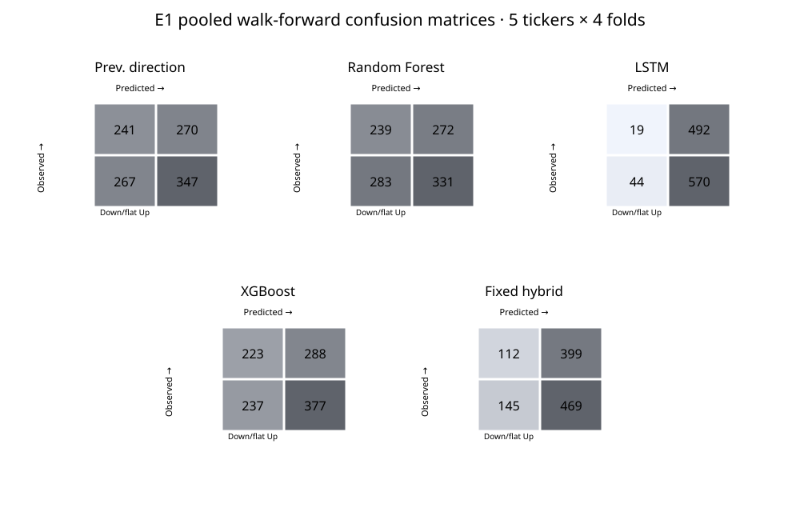
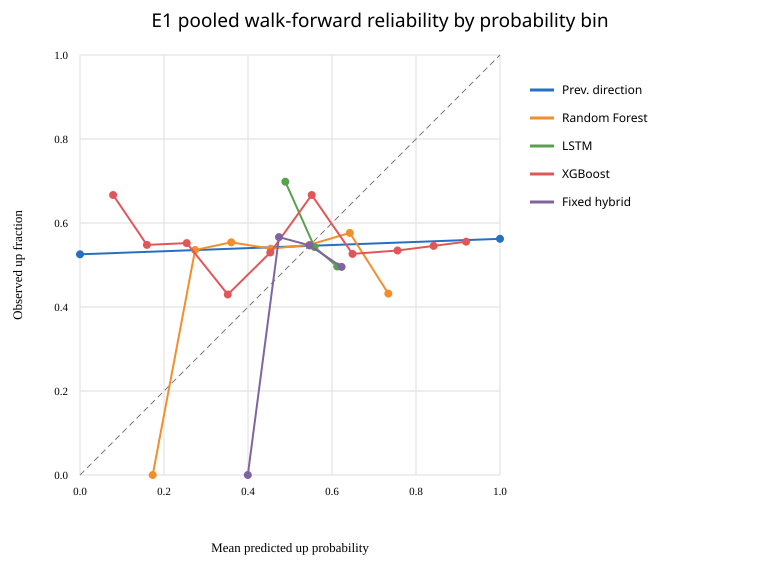
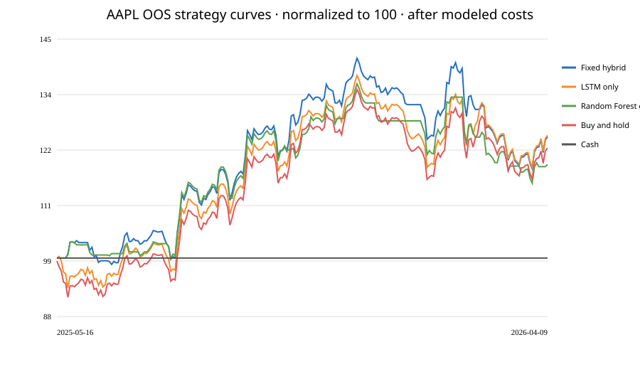

# Phase 9 — Final experiment matrix and evidence report

**Status:** Completed with E5 explicitly unavailable. No metric below is evidence of future profitability.

## Method and common design

The next-session target is adjusted close at session t+1 greater than adjusted close at t. E1 uses four expanding train/validation/test folds inside the first 80% of three years of Yahoo adjusted daily bars, with the later 20% holdout excluded from its fold means. E2–E7 use the AAPL development OOS window from 2025-05-16 through 2026-04-09 unless marked unavailable. Trading uses daily close signal generation, next available open execution, long-only fractional sizing, 0.06% fees and 0.04% slippage, and terminal liquidation.
E2–E7 strategy comparisons use one retained AAPL OHLCV input frame (SHA-256 `94bf5ba4720da5dbbf597317ee44ac0f143528f7fb0f9c13eaf79f19418c33e3`), so the compared arms share exact market data in addition to the same test dates and costs.

E1 uses five symbols across Technology, Financials, Healthcare and Energy. Equal-ticker means are reported; standard deviations in that table describe cross-ticker spread. Per-ticker fold mean ± SD is included in the machine-readable JSON. The held-out 20% was previously examined in Phase 1 and is not used for E1 fold conclusions.

## E1 — Base models

Equal-ticker mean metrics across five symbols (four walk-forward folds per symbol):

| Model | Accuracy | Balanced accuracy | ROC-AUC | Brier |
|---|---:|---:|---:|---:|
| Previous direction | 0.5229 | 0.5117 | 0.5117 | 0.4771 |
| Random Forest | 0.5067 | 0.5114 | 0.5176 | 0.2607 |
| LSTM | 0.5236 | 0.4902 | 0.4806 | 0.2513 |
| XGBoost | 0.5333 | 0.5330 | 0.5179 | 0.2906 |
| Fixed hybrid | 0.5165 | 0.4982 | 0.5092 | 0.2509 |

XGBoost had the highest mean accuracy (0.5333) and balanced accuracy (0.5330), but its Brier score (0.2906) was worse than RF (0.2607), LSTM (0.2513), and fixed hybrid (0.2509). The result is mixed and descriptive, not a model superiority claim.

## Model and evaluation details

Features: `return_1d, return_5d, sma20_gap, sma50_gap, rsi, macd, macd_signal, bb_position, volume_change`. Sequence scaling uses a MinMaxScaler fit on each fold's training rows only; LSTM early stopping uses validation rows. Random Forest uses 250 trees, max depth 7, min leaf size 4 and balanced class weights; LSTM uses a 30-session lookback, 48 units, up to 6 epochs and validation early stopping; XGBoost uses the enabled optional tabular configuration. Seed is 42 where supported.

The fixed hybrid uses LSTM 0.40, Random Forest 0.40, neutral FinBERT 0.10 and technical evidence 0.10. Adaptive weights omit unavailable historical FinBERT, score components by validation Brier skill against 0.50, combine scores with renormalized fixed priors, and project onto configured weight bounds. The HMM uses daily return, rolling volatility, normalized range and volume change; scaler/state mapping are trained on prior rows and inference is causal. Calibration compares Platt and isotonic candidates on chronological validation partitions; uncertainty is component standard deviation; No Trade thresholds are validation-selected and frozen for each next test fold.

## E2 — Ensemble effect

On the shared AAPL OOS trading window, the best single component was LSTM-only at **25.42%** return, Sharpe 1.2518, and -13.7985% max drawdown. Fixed hybrid returned **25.1038%**, Sharpe 1.2878, and -16.1417% max drawdown. Fixed hybrid Sharpe was slightly higher, but its return was lower and drawdown larger than LSTM in this sample.

## E3 — Adaptive fusion

Fixed hybrid returned **25.1038%** (Sharpe 1.2878, drawdown -16.1417%); adaptive hybrid returned **14.2802%** (Sharpe 0.8238, drawdown -18.7356%). Adaptive weighting underperformed fixed weighting on return and Sharpe, and had a larger drawdown.

## E4 — Regime effect

The paired experiment uses the exact same saved input CSV (SHA-256 `94bf5ba4720da5dbbf597317ee44ac0f143528f7fb0f9c13eaf79f19418c33e3`), OOS dates and fold boundaries. The treatment allows validation scores to be selected within the current regime when evidence is sufficient; the control selects from the overall validation window. Treatment return/Sharpe/drawdown: **14.2802% / 0.8238 / -18.7356%**. Control: **14.2802% / 0.8238 / -18.7356%**. One audited signal label differed (2025-08-05: BUY with regime vs HOLD without); the executed equity curves and aggregate trading metrics were identical. Regime-aware selection occurred on 220 audit rows; five used overall validation fallback. This one-symbol experiment does not establish a robust benefit. HMM state stratification alone is not causal evidence.

## E5 — Sentiment ablation

**Not evaluable.** No eligible point-in-time historical news corpus was available. The experiment did not substitute current headlines into historical dates. Historical FinBERT contribution remains neutral, and no sentiment value claim is made.

## E6 — Uncertainty / No Trade

Raw fixed Brier was 0.2532; calibrated fixed Brier was 0.2676, so calibration worsened this metric. The validation-selected No Trade policy abstained on 37 of 225 audited signals. It returned **10.1851%**, Sharpe 0.7945, drawdown -13.7985%; fixed hybrid returned 25.1038%, Sharpe 1.2878, drawdown -16.1417%. Drawdown was less severe, but return and Sharpe were lower. This threshold does not run on live predictions.

## E7 — Trading validation

| AAPL strategy | Return | Sharpe | Max drawdown | Turnover | Trades |
|---|---:|---:|---:|---:|---:|
| Fixed hybrid | 25.1038% | 1.2878 | -16.1417% | 11.2597 | 12 |
| LSTM only | 25.42% | 1.2518 | -13.7985% | 1.9131 | 2 |
| Random Forest only | 19.3772% | 1.1137 | -15.1112% | 41.4641 | 42 |
| Buy and hold | 22.7918% | 1.1746 | -13.7985% | 1.9311 | 2 |
| Cash | 0.0% | 0.0 | 0.0% | 0.0 | 0 |

## E3 per-fold results

Each fold uses the same dates for fixed and adaptive and starts from fresh capital; these are not additive to the continuous results.

| Fold | Test dates | Fixed return | Adaptive return | Fixed Sharpe | Adaptive Sharpe |
|---:|---|---:|---:|---:|---:|
| 1 | 2025-05-16 to 2025-08-07 | 5.0269% | 1.0741% | 1.3525 | 0.3746 |
| 2 | 2025-08-08 to 2025-10-27 | 15.082% | 15.082% | 2.8725 | 2.8725 |
| 3 | 2025-10-28 to 2026-01-16 | -2.0722% | -4.2098% | -0.7194 | -1.4568 |
| 4 | 2026-01-20 to 2026-04-09 | -2.2021% | -4.8712% | -0.3058 | -0.903 |

Fixed hybrid exceeded buy-and-hold return in this window, with a larger drawdown. LSTM-only return was slightly higher than fixed hybrid. These are single-window simulated outcomes after modeled costs, not live or investable results.

## Figures and audit artifacts

The E1 confusion matrices are pooled by summing the four fold matrices per ticker across the five symbols. The calibration plot aggregates each fold's reliability bins using bin counts. Equity curves, trade records, data hashes, fold dates, configuration, calibration bins, and signal audits are retained in the linked JSON artifacts.

## Limitations

- Five selected large-cap symbols and one recent three-year provider window do not represent a broad universe.
- E1 fold means are descriptive; cross-ticker standard deviation is not a confidence interval. XGBoost's higher accuracy coincides with a worse Brier score.
- The final holdout was previously evaluated during Phase 1 and is exploratory; Phase 9 E1 fold metrics exclude it.
- E2 through E7, except E1, are based on one AAPL window and four folds.
- E4 tests regime-specific versus overall validation weight selection, not whether an HMM regime label improves the forecasting model generally. Small regime groups can fall back to overall validation evidence.
- E5 could not be run without eligible historical point-in-time news; historical sentiment remains neutral.
- Calibration worsened pooled Brier in Phase 5; live calibration and No Trade thresholds remain unavailable.
- Daily adjusted Yahoo bars, constant transaction costs/slippage, and next-open fills omit intraday path, spread, market impact, partial fills, taxes, and funding costs.
- LSTM CPU training on native Windows is nondeterministic to some extent; exact floating-point replay may vary. E4 arms share the identical saved source CSV and dates.
- No significance tests or confidence intervals were run; no result establishes future profitability.

### Future work

Run a later untouched confirmation period across a wider, predeclared ticker universe; add significance/uncertainty analysis; repeat adaptive and regime ablations across symbols; obtain appropriately licensed point-in-time news before sentiment ablation; and only enable live calibration/No Trade after a leakage-safe live validation path exists.

## Reproducibility

Source run IDs: E1 `20261031T141506.545871Z`, E2/E7 `20261031T143310.903036Z`, E3 `20261031T143310.903036Z`, E6 `20261031T143310.903036Z`, E4 treatment `20261031T143310.903036Z`, E4 control `20261031T143113.516158Z`.
Model/strategy versions include E1 `direction-rf-walk-forward-v2`, hybrid `walk-forward-hybrid-next-open-v1`, adaptive `validation-brier-regime-weights-v1`, regime `gaussian-hmm-market-regimes-v1`, and calibration `validation-selected-platt-isotonic-v1`.
- E1 source report: `phase7_xgboost_evaluation.json` (report-only regeneration: `tools/run_real_evaluation.py --output research/real_data/phase7_xgboost_evaluation.json --report-only`).
- E4 paired runs: `tools/run_adaptive_evaluation.py --symbol AAPL --input-csv research/real_data/phase9_e4_aapl_prices.csv --output research/real_data/phase9_e4_with_regime.json` and repeat with `--without-regime-weights` and the other output path.
- Regenerate this report and figures: `python tools/build_phase9_report.py`.
- Package versions, model configurations, fold boundaries, hashes, and full audit data are recorded in the JSON reports listed in `phase9_final_experiment_matrix.json`.
